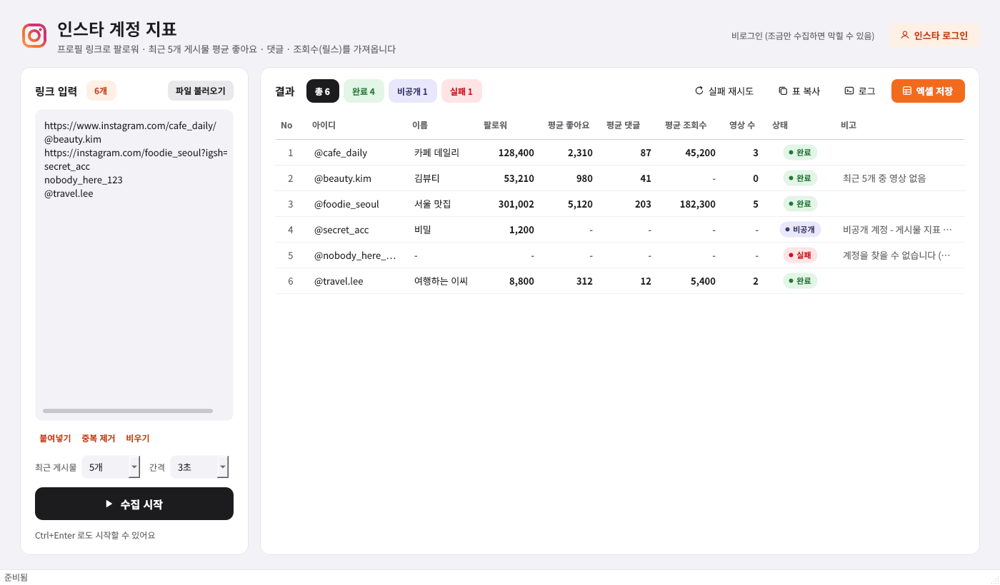

# 인스타 크롤러 1.0 (MVP)

인스타 프로필 링크 목록을 넣으면 계정별 **팔로워 · 최근 5개 게시물 평균 좋아요 · 평균 댓글 · 평균 조회수(릴스)** 를 모아 엑셀로 내보내는 윈도우 프로그램.
네이버 크롤러와 별도 exe (`InstaCrawler.exe`).



## 수집 항목

| 열 | 내용 |
|---|---|
| 아이디 · 이름 · 프로필 링크 | 계정 아이디, 프로필 이름 |
| 팔로워 | 수집 시점 팔로워 수 |
| 평균 좋아요 · 평균 댓글 | 올린 날짜 최신순 5개 게시물 평균 (상단 고정 게시물도 날짜순으로만 포함) |
| 평균 조회수 | 그 5개 중 **영상(릴스)만** 평균. 사진 조회수는 인스타가 공개하지 않음 |
| 영상 수 | 조회수 평균에 쓴 영상 개수 |

- 게시물 수(기본 5개)는 왼쪽 `최근 게시물` 에서 1~12개로 바꿀 수 있다
- 좋아요를 숨긴 게시물은 좋아요 평균에서 빼고 비고에 남긴다
- 비공개 계정은 팔로워만 수집하고 상태 `비공개`

## 입력

한 줄에 하나. 글이 섞여 있어도 인스타 링크만 골라 읽는다. txt / csv / xlsx 파일을 끌어다 놓아도 된다.

```
https://www.instagram.com/아이디/
instagram.com/아이디?igsh=...      (앱 공유 링크)
@아이디
아이디
https://www.instagram.com/reel/코드/  (게시물 · 릴스 링크 → 로그인 상태에서만 작성자로 바꿔 수집)
```

## 로그인

로그인 없이도 되지만 인스타가 짧은 시간에 많이 조회하면 잠시 막는다. 수십 개 이상이면 로그인 권장.

1. 오른쪽 위 **인스타 로그인** → 크롬 창이 뜸
2. 그 창에서 인스타 로그인 → 로그인되면 창이 자동으로 닫히고 `인스타 로그인됨` 표시
3. 다음 실행에도 유지. 끄려면 `로그아웃`

- 수집은 크롬 없이 저장된 로그인 정보로 한다 (크롬은 로그인할 때만 뜸)
- 로그인 상태면 릴스 조회수가 앱에 보이는 재생수 기준으로 더 정확하다
- **대량 조회는 계정 제한 위험이 있으니 회사 메인 계정 말고 서브 계정 권장**
- 로그인 정보는 `%APPDATA%\InstaCrawler\session.json` 에 저장된다

## 요청 제한에 걸렸을 때

인스타가 막으면 90초 기다렸다 한 번 다시 시도하고, 그래도 막히면 수집을 멈춘다 (남은 항목은 `대기`).
몇 분 뒤 **실패 재시도** 를 누르면 실패 · 대기 항목만 이어서 한다. 간격(기본 3초)을 늘리거나 로그인하면 덜 막힌다.

## 설치

### A. exe 만들기
1. [Python 3.10 이상](https://www.python.org/downloads/) 설치 (**Add python.exe to PATH** 체크)
2. 저장소 내려받아 압축 풀기
3. `build_insta.bat` 더블클릭 → `dist\InstaCrawler.exe`

> GitHub **Actions → Build Insta exe → Run workflow** 로 만든 exe 를 내려받을 수도 있다.

### B. 빌드 없이 실행
`run_insta.bat` 더블클릭.

로그인 기능에만 크롬이 필요하다 (평소 쓰는 크롬이면 됨, 드라이버는 자동 설치).

## 개발

```
insta_crawler/
  parsing.py    링크 → 아이디, 인스타 응답 → 게시물 지표 · 평균 (순수 함수)
  client.py     인스타 웹 내부 API 요청 · 오류 구분 (없음 / 요청 제한 / 로그인 필요)
  collector.py  계정 하나 수집 + 목록 순서대로 실행 (제한 시 대기 · 중단)
  login.py      크롬으로 로그인 → 쿠키 저장
  files.py      링크 파일 읽기 · 엑셀 저장 (팀 리스트 양식)
  theme.py      색 · 아이콘 (네이버 크롤러와 같은 톤)
  ui.py         화면
```

```bash
pip install -r requirements-dev.txt
pytest -q tests/test_insta.py
python -m insta_crawler --cli 아이디1 아이디2   # 화면 없이 실제 인스타로 확인
```
